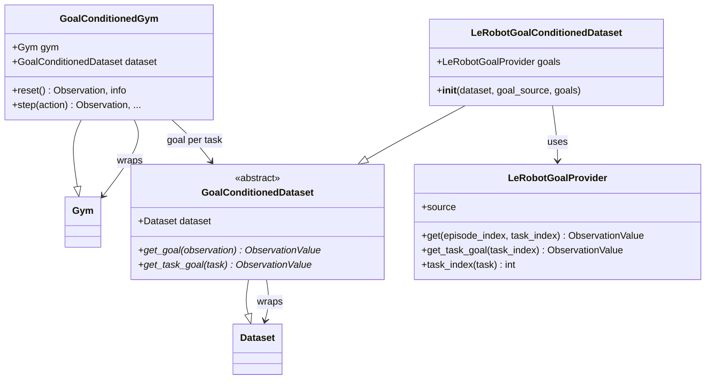

# Goal Conditioning

A goal-conditioned policy gets a goal with every observation. The goal shows the
state the policy should reach.

This matters for multi-task benchmarks like LIBERO-goal. All tasks start from the
same scene. Without a goal, the policy cannot tell which task to do.

The goal is the **last frame of a demonstration**. It is added in training and
in rollouts, so the policy always sees the same fields.

## Observation Field

| Field         | Constant      | Content                                     |
| ------------- | ------------- | ------------------------------------------- |
| `goal_images` | `GOAL_IMAGES` | Goal images, in the same layout as `images` |

It is `None` when goals are off.

## Architecture



- `GoalConditionedDataset` adds a goal to each training sample.
- `LeRobotGoalConditionedDataset` does this for LeRobot datasets.
- `GoalConditionedGym` adds a goal to each rollout observation.

## Training

Each sample uses the last frame of its own episode as the goal. The provider
reads only from the wrapped dataset instance and only uses episodes selected for
that instance. A held-out validation episode therefore cannot supply a training
goal.

```python test="skip" reason="requires physicalai install and downloads data"
from lerobot.datasets.lerobot_dataset import LeRobotDataset

from physicalai.data.lerobot import LeRobotDataModule, LeRobotGoalConditionedDataset

# Let the datamodule add goals
datamodule = LeRobotDataModule(repo_id="lerobot/libero", goal_source="episode")

# Or wrap the dataset yourself
dataset = LeRobotGoalConditionedDataset(LeRobotDataset("lerobot/libero"))
datamodule = LeRobotDataModule(dataset=dataset)
```

By default, each selected episode uses its last frame. To choose a goal frame,
pass frame offsets within each episode. Offsets are zero-based; negative offsets
count from the end, so `-1` selects the last frame. Provide one offset per dataset
episode, or one per selected episode when wrapping a filtered split:

```python
from lerobot.datasets.lerobot_dataset import LeRobotDataset

dataset = LeRobotDataset("lerobot/libero")
goal_indices = [-1] * dataset.meta.total_episodes
datamodule = LeRobotDataModule(dataset=dataset, goal_indices=goal_indices)
```

The same list can be stored in a JSON file as a top-level array of integers and
passed as `goal_indices="goal_indices.json"`. With `val_split`, use a full-dataset
list so train and validation episodes map to their own offsets. Supplying
`goal_indices` enables goal conditioning; otherwise it remains opt-in through
`goal_source="episode"`.

Goals need `data_format="physicalai"`.

## Rollouts

`GoalConditionedGym` adds the goal for the gym's current task:

```python test="skip" reason="requires LIBERO and downloads data"
from lerobot.datasets.lerobot_dataset import LeRobotDataset

from physicalai.data.lerobot import LeRobotGoalConditionedDataset
from physicalai.gyms import GoalConditionedGym, LiberoGym

dataset = LeRobotGoalConditionedDataset(LeRobotDataset("lerobot/libero"))
gym = GoalConditionedGym(LiberoGym(task_suite="libero_goal", task_id=3), dataset)

obs, _ = gym.reset(seed=0)
obs.goal_images["image"].shape  # torch.Size([1, 3, 256, 256])
```

- On each reset, the gym's task text is matched to a dataset task.
- The gym uses the first selected episode's terminal frame for that task.
- The goal matches the gym's batch size and camera names.
- Use `camera_map` if camera names differ.

## Caveats

- **The last frame must show the finished task.** This is true for PushT and
  LIBERO. It is not true for
  [cyclic recordings](../../how-to/data/recording-a-dataset.md#the-single-most-important-rule-record-cyclic-episodes),
  where the arm returns home. Crop those episodes to end when the task is done.
- **Gyms must report their task** in `Observation.task`. The text must match a
  dataset task.
- **Policies must normalise goals.** Use the same statistics as `images`.
- **Goal conditioning requires `delta_timestamps=None`.** A goal is one terminal
  frame, not a temporal window.
- **Check your goals.** Save a few `goal_images` and look at them before
  training.

## See Also

- [LeRobot Data Integration](lerobot.md)
- [Observation](observation.md)
- [GoalConditionedGym](../gyms/goal.md)
